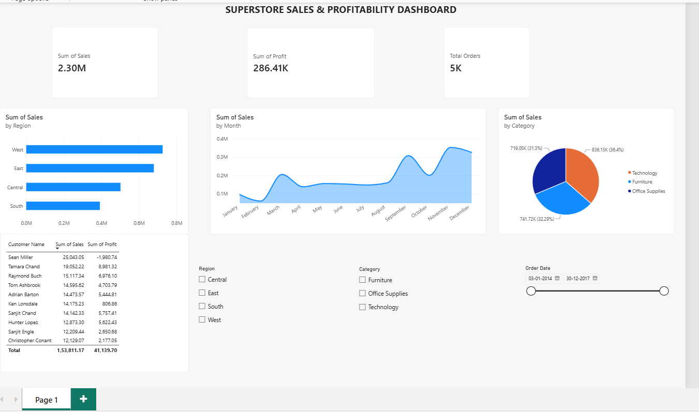

# Maincrafts-Data-Analytics-Task1
# Superstore Sales & Profitability Analysis

**Data Analytics & Business Intelligence Internship — Task 1**  
**Organization:** Maincrafts Technology  
**Author:** Debasish Panigrahi  

---

### Overview
This repository contains my end-to-end sales and profitability analysis of the **Sample – Superstore** retail dataset (`9,993` cleaned transactions spanning January 2014 to December 2017). Using **Microsoft Excel**, **SQLite**, and **Power BI**, the project identifies regional revenue drivers, seasonal buying patterns, category margin bottlenecks, and how promotional discounting impacts net profit.

---

### Interactive Power BI Dashboard

---

### Repository Contents
* **`cleaned_sales_data.xlsx`** — Standardized dataset (`Sales_Data` tab) along with KPI summaries and 5 pivot tables (`EDA_Summary` tab).
* **`sales_analysis.sql`** — Table schema (`CREATE TABLE`) and 5 analytical SQL queries covering regional revenue, top profitable products, monthly trends, discount tiers, and category margins.
* **`sales_dashboard.pbix`** — Interactive single-page Power BI Desktop dashboard featuring dynamic slicers for Region, Category, and Order Date.
* **`dashboard_screenshot.png`** — Full-view snapshot of the final Power BI dashboard.
* **`Business_Insights_Report.pdf`** — Executive report summarizing key findings and practical recommendations for management.

---

### Key Findings at a Glance
* **Overall Performance:** Generated **$2,296,919.49** in total sales across **5,009 unique orders**, delivering **$286,409.08** in net profit (**12.47%** margin).
* **Regional Performance:** The **West** region leads in both revenue (**$725,457.82**) and profit (**$108,418.45**, **14.94%** margin), while **Central** lags with a **7.92%** margin despite ranking third in sales.
* **The Furniture Margin Bottleneck:** Furniture brings in **32.29%** of total revenue (**$741,718.42**) but yields only a **2.49%** profit margin (**$18,463.33** profit), dragged down by bulky items like Tables and Bookcases combined with heavy markdowns.
* **The 20% Discount Cliff:** Discounts between **0% and 20%** stay consistently profitable, whereas every discount tier from **30% to 80%** loses money on average—eroding over **$135,000** in gross profit.
* **Fourth-Quarter Seasonality:** Over **37%** of annual revenue occurs in Q4, peaking in **November ($352,461.07)** and **December ($325,293.50)** after a Q1 trough in February.

---

### Recommendations
1. **Cap Standard Discounts at 20%:** Require manager sign-off for any discount above 20% to prevent routine 30%–80% markdowns from wiping out margins.
2. **Rework Furniture Pricing & Bundling:** Audit loss-making Furniture SKUs in the Central region, introduce shipping surcharges on heavy items, and bundle high-margin Office Supplies with Furniture orders.
3. **Plan Inventory Around Q4 Peaks:** Build up Technology and Office Supplies stock by August ahead of the September–December surge, and run targeted 20%-capped B2B offers in February to lift slow Q1 demand.
